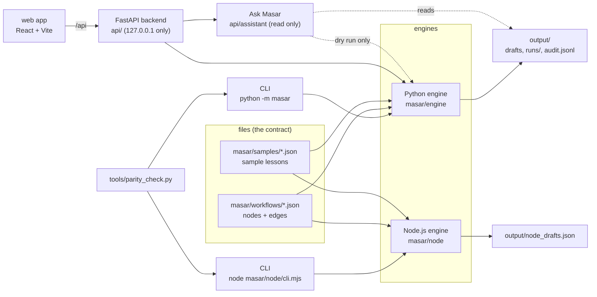
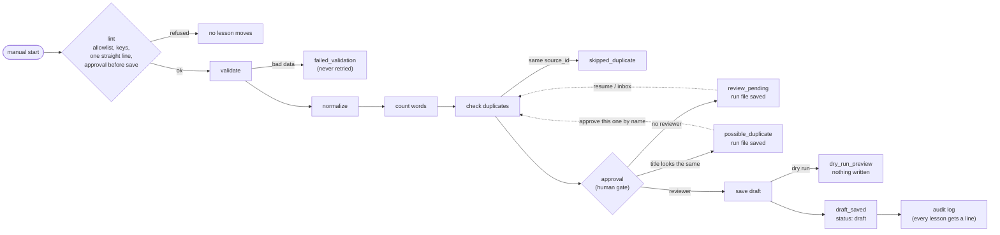

# Architecture

## The parts

- **The workflow file is the contract.** Both engines read the same JSON and give the same status
  for every lesson. `tools/parity_check.py` proves it on 7 cases.
- **The engine owns the rules.** Approval, drafts only and "dry run writes nothing" are in the
  engine. The CLI, the backend and the web app all go through it, so none of them can skip a rule.
- **Only the Python engine keeps state** (run files, resume, retry, audit chain), because the
  backend uses it. The Node engine has every node and linter rule, so it runs every workflow file.
- **Ask Masar** only reads runs and drafts. Its one engine call is a dry run with an empty temp store.

## One run

- **A pause is saved state.** A lesson that waits for a person is written to `output/runs/<run_id>.json`
  and the program ends. A resume reads it later and starts again at the duplicate check, because
  another run may have saved the same lesson in the meantime.
- **Every station adds a line to the trace:** the data before and after, the time, and whether it
  went on, stopped or failed. Replay in the web app shows this, station by station.
- **Errors have types.** `ValidationError` (bad data) is never retried. `TransientError` (timeout,
  503) is retried after 1s, 2s, 4s, and a `retry_after` over 30s stops at once. A bug in a node is
  `failed_error`: that lesson stops, the others go on.
- **The audit log** gets one line per lesson and per decision. Each line keeps the hash of the line
  before it, and each run file keeps the last hash, so `verify-audit` finds an edited, removed or cut line.

## Where each safety rule lives

| Rule | Where |
|---|---|
| Only known node types run, no code in JSON | `masar/engine/lint.py` (allowlist in `registry.py`) |
| No save without approval before it | linter rule + `save_draft` also checks the reviewer name |
| No reviewer name, nothing saved | `executor.py` trims the name once, `manual_approval` stops |
| Dry run writes nothing | `executor.py`: everything that writes is behind `if not dry_run` |
| Every saved record is a draft | `save_draft` sets `status: "draft"` |
| From the web, saving only in the inbox | `api/service.py`: `approved_by` only with `dry_run` |
| Local only | `api/__main__.py` binds 127.0.0.1, trusted hosts, CORS only for the web app |
| Ask Masar cannot act | `api/assistant/` has no write function; a test reads its code |
