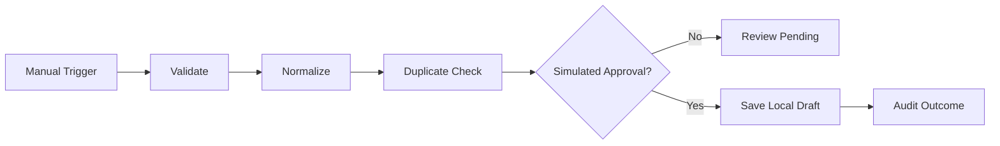

# Architecture Notes — From a Linear Prototype to an Automation Platform

## What works in this starter

- One **manual** trigger defined in `workflow.json`
- A **linear** node sequence with a JSON `nodes` array and `edges` array
- Shared context for each synthetic Dorosak lesson
- Validation, normalization, duplicate detection, simulated reviewer gate, draft-only local save
- Local execution report and unit tests in Python and Node.js

## What is deliberately NOT included

Real authenticated approvals, an n8n-style canvas, DAG branching/merges, scheduler, HTTP triggers, queues, encrypted credentials, database transactions, concurrent writes, real retry logic, distributed idempotency, observability, multi-tenant access controls or Dorosak API integration.

## Suggested next architecture (separate milestones)

1. **API contract:** create versioned HTTP endpoints for workflows, runs, and content-review decisions. Introduce JSON Schema or type validation.
2. **State storage:** PostgreSQL tables for `workflows`, `workflow_versions`, `runs`, `steps`, `review_requests`, `connector_credentials` and `audit_events`.
3. **Workflow graph:** validate DAG topology, reject cycles, support conditional paths and merge semantics. Establish a durable state machine.
4. **Worker execution:** queue-based jobs, retry with exponential backoff for transient failures, idempotency keys, timeouts and dead-letter queues.
5. **Permissions:** authenticated users, RBAC, tenant isolation, reviewers with explicit publish permission. Do not treat a user-provided string as approval.
6. **Editor:** browser canvas with visual nodes and connectors. Persist graph JSON. Keep execution separate from rendering.
7. **Connectors:** sandbox Dorosak staging integration first, then CRM/ERP/helpdesk with least-privilege API scopes.
8. **Governance:** logs with PII redaction, approvals, versioning, deployment gates, rollback, budgets and monitoring.

## Production integration boundary example

- `POST /staging/content-drafts` accepts ONLY validated data with a unique request key.
- The service authorizes the caller and enforces tenant/object-level access checks.
- Draft creation and audit insert happen transactionally.
- `POST /staging/drafts/{id}/publish` is a separate privileged operation requiring authenticated reviewer approval.
- There is no production URL, secret or live publishing code in this workshop.

## Sample acceptance criteria for the next sprint

- A workflow can be inspected and validated without execution.
- Each run is attributed to an authenticated principal and immutable workflow version.
- Retrying a transient failed step does not duplicate a published/saved object.
- Approval actions are tied to an authenticated reviewer and immutable audit event.
- Branches cannot bypass approval or privilege checks.
- All production writes can be disabled globally with a kill switch.
